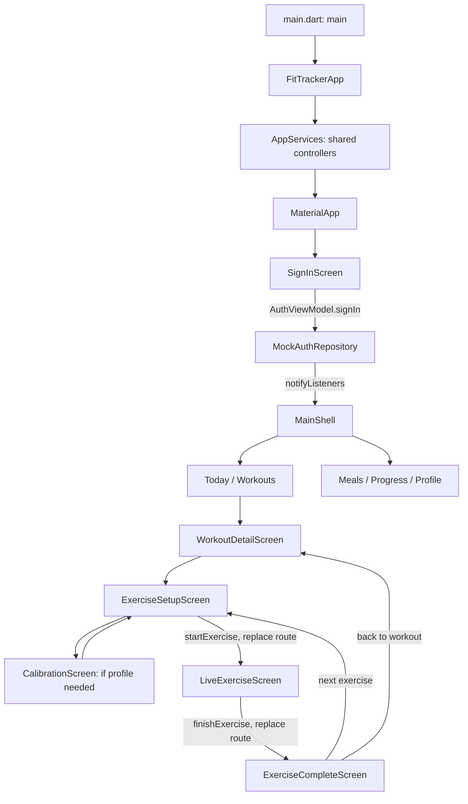

# Learning this FitTracker project

Start here, then open the linked source files. The workout flow now uses real BLE and local storage; see [BLE setup](BLE_WORKOUT_SETUP.md) for the hardware instructions and firmware changes. The Dart files under `lib/` now have comments above their classes, constructors, methods, fields, and local values. A file’s “Imported by” header lists direct imports from other app files; a class/method comment describes its runtime caller. Importing a file makes names available; it does not itself call its functions.

## What the warnings meant

The initial `flutter analyze` run found **13 info-level diagnostics, no warnings and no errors**:

- `live_exercise_screen.dart`: deprecated `WillPopScope`, plus missing braces around an `if` body.
- `calibration_screen.dart`: missing braces around an `if` body.
- `today_screen.dart`: two suggestions to use constant widgets/lists.
- Tests: eight relative imports from `lib/`, now replaced with `package:repform_app/...` imports.

The text beginning “class ScaffoldMessenger extends StatefulWidget” is editor hover documentation. The `SnackBar(...)` list is a constructor signature showing available arguments. Neither is an error message. “deprecated” means an API still exists but has a replacement you should migrate to.

`Scaffold` supplies a screen’s app bar and body. `SnackBar` describes a short message. `ScaffoldMessenger.of(context).showSnackBar(...)` asks the messenger above this screen to display that message. `MaterialApp` provides the messenger here. The live screen uses this to report save/stop failures. See Flutter’s [ScaffoldMessenger documentation](https://api.flutter.dev/flutter/material/ScaffoldMessenger-class.html) and [SnackBar documentation](https://api.flutter.dev/flutter/material/SnackBar-class.html).

The live screen now uses `PopScope<void>`. `canPop: false` prevents system back from immediately leaving an active exercise. `onPopInvokedWithResult` receives `didPop` (whether the route actually closed) and `result` (unused here). A blocked attempt calls `_stop()`. After confirmation and successful cleanup, `_stop()` explicitly calls `Navigator.pop(context)`. When that succeeds, `didPop` is true and no second dialog is opened. Close and Stop use the same method. `_busy` prevents competing stop/save requests. The live body also uses `CustomScrollView` with `SliverFillRemaining`: it fills taller screens and scrolls when the controls need more vertical room. See Flutter’s [PopScope documentation](https://api.flutter.dev/flutter/widgets/PopScope-class.html).

While `canPop` is false, a predictive-back exit animation is intentionally unavailable. On iOS, the Cupertino swipe gesture may not report a blocked attempt; the visible Close/Stop buttons remain available. This is documented platform behavior, not evidence that confirmation has been skipped.

## Languages and folders

Most of this app is **Dart**, using the **Flutter** UI framework. You do not need Java to read `lib/`. The Android launcher is a small **Kotlin** class in `android/app/src/main/kotlin/com/repform/repform_app/MainActivity.kt`; it extends FlutterActivity and hosts Flutter’s UI.

| Location | What to learn from it |
| --- | --- |
| `lib/main.dart` | The entry point: where execution begins. |
| `lib/app/` | Startup, shared controllers, and visual theme. |
| `lib/core/` | Widgets and date helpers reused by multiple features. |
| `features/*/presentation/` | Screens plus controllers called view models. |
| `features/*/domain/` | Data shapes and application rules. |
| `features/*/data/` | Interfaces and adapters that supply/store data. |
| `test/` | Automated checks, separate from the running app. |
| `pubspec.yaml` | Package name, SDK constraint, and dependencies. |
| `pubspec.lock` | Resolved dependency versions; generated by package resolution. |
| `analysis_options.yaml` | Analyzer/lint configuration. |
| `android/` | Android packaging, permissions, Kotlin launcher, and Gradle build configuration. |
| `.dart_tool/`, `build/` | Generated tool/build output; do not learn app logic by editing these. |

## Follow the app from startup



`push` adds a route to the navigation stack. `pop` removes the current route. `pushReplacement` swaps the current route, so Back does not reopen setup after the exercise has started. Calibration uses `push` so saving can `pop` back to setup.

### File and class map

All paths below link to actual application source. Private `_...State` classes live beside their matching screen and hold values that can change.

| Source | Main definitions and where they are used |
| --- | --- |
| [main.dart](../lib/main.dart) | `main()` initializes Flutter bindings and calls `runApp(FitTrackerApp())`. |
| [fittracker_app.dart](../lib/app/fittracker_app.dart) | `FitTrackerApp` / `_FitTrackerAppState`: `initState()` creates auth/workout controllers and loads plans. `build()` installs services, theme and sign-in/home selection. `dispose()` releases controllers. |
| [app_services.dart](../lib/app/app_services.dart) | `AppServices`: `auth` and `workouts` are shared controllers. Screens call `of(context)`. `updateShouldNotify()` compares controller identities. |
| [fittracker_theme.dart](../lib/app/fittracker_theme.dart) | `FitColors` supplies colors throughout the UI. `fitTheme(brightness)` builds both themes for the root. `ThemeViewModel.mode/isDark/toggle()` connect the root app to the profile switch. |
| [date_labels.dart](../lib/core/utils/date_labels.dart) | `weekdayLabel`, `shortWeekday`, `shortMonth`, `longDate`, `shortDate`, `friendlyTime` format labels; `isSameDate` supports calendar filtering and workout rules. Callers include Today, Workouts, cards, details and Progress. |
| [fit_widgets.dart](../lib/core/widgets/fit_widgets.dart) | `FitCard`, `SectionHeading`, `FitBadge`, `AccentButton`, `StatTile` are shared UI building blocks. Their fields are inputs from the parent screen; `build()` turns those inputs into widgets. |
| [auth_repository.dart](../lib/features/auth/data/auth_repository.dart) | `AppUser` stores `id/displayName/email`. `AuthRepository` defines `signInWithGoogle/signOut`; the auth controller depends on this contract. |
| [mock_auth_repository.dart](../lib/features/auth/data/mock_auth_repository.dart) | `MockAuthRepository` implements that contract and returns a fixed user after a delay. Selected by the root app. |
| [auth_view_model.dart](../lib/features/auth/presentation/auth_view_model.dart) | `AuthViewModel`: `signIn()` updates `_user/_busy/_error`; `signOut()` clears `_user`. Root, sign-in and profile read its getters. |
| [sign_in_screen.dart](../lib/features/auth/presentation/sign_in_screen.dart) | `SignInScreen` is shown by the root while signed out; its button calls `signIn()` and its listener redraws busy/error feedback. |
| [main_shell.dart](../lib/features/shell/presentation/main_shell.dart) | `MainShell` / State: `_selected` chooses one of `_pages`; the account button opens `ProfileScreen`. |
| [today_screen.dart](../lib/features/home/presentation/today_screen.dart) | `TodayScreen` / State: `_selectedDay` controls filtering; `_calendar()` creates the week row; ready cards open workout details. |
| [meals_screen.dart](../lib/features/meals/presentation/meals_screen.dart) | `MealsScreen` is a static placeholder tab in MainShell. |
| [profile_screen.dart](../lib/features/profile/presentation/profile_screen.dart) | `ProfileScreen` receives `theme` from MainShell; reads the user, calls `theme.toggle()` and `auth.signOut()`. |
| [progress_screen.dart](../lib/features/progress/presentation/progress_screen.dart) | `ProgressScreen` listens to the workout controller and displays results grouped by workout and exercise. |
| [tracker_device.dart](../lib/features/tracker/domain/tracker_device.dart) | `TrackerDevice.id/batteryPercent` feed the setup device picker; device ID also goes into saved results. |
| [tracker_gateway.dart](../lib/features/tracker/data/tracker_gateway.dart) | `TrackerGateway` declares scanning, connecting, disconnecting, calibration, start/pause/resume/stop, disposal and a count stream. WorkoutViewModel calls it. `disconnect()` has no app UI caller yet. |
| [mock_tracker_gateway.dart](../lib/features/tracker/data/mock_tracker_gateway.dart) | `MockTrackerGateway` is an explicitly injected test/demo adapter. Normal launches use `BleTrackerGateway` and `FlutterBleTransport`. |
| [workout_models.dart](../lib/features/workouts/domain/workout_models.dart) | `ExercisePlan`, `WorkoutPlan`, `ExerciseResult` are data containers; `exerciseKey()` and `ExerciseResult.key` identify a result by workout/exercise IDs. |
| [workout_policy.dart](../lib/features/workouts/domain/workout_policy.dart) | `WorkoutAvailability` names statuses. `WorkoutPolicy.exerciseCompleted/workoutCompleted/availability/exerciseUnlocked/targetReached` are rules called by the workout controller. |
| [workout_repository.dart](../lib/features/workouts/data/workout_repository.dart) | `WorkoutRepository.fetchWorkouts/fetchResults/saveResult` describe storage operations used by the controller. |
| [demo_workout_repository.dart](../lib/features/workouts/data/demo_workout_repository.dart) | `DemoWorkoutRepository._buildPlans()` supplies starter prescriptions. The root selects `LocalWorkoutRepository`, which dates the IDs and persists plans/results without importing fabricated completions. |
| [workout_view_model.dart](../lib/features/workouts/presentation/workout_view_model.dart) | `WorkoutViewModel` coordinates all workout data and device actions. Detailed call map below. |
| [workouts_screen.dart](../lib/features/workouts/presentation/workouts_screen.dart) | `WorkoutsScreen` groups plans in `days`; `_dayHeading()` formats each group; ready cards open details. |
| [workout_card.dart](../lib/features/workouts/presentation/workout_card.dart) | `WorkoutCard` receives `workout/vm/onTap` from Today or Workouts; `status/locked/label` determine its presentation. |
| [workout_detail_screen.dart](../lib/features/workouts/presentation/workout_detail_screen.dart) | `WorkoutDetailScreen` receives the selected workout. `_exerciseTile()` reads completion/unlock status and opens setup. |
| [exercise_setup_screen.dart](../lib/features/workouts/presentation/exercise_setup_screen.dart) | `ExerciseSetupScreen` / State: `_scan/_connect/_prepare/_start` handle real BLE actions; `_error` displays failures. `_devices/_choosing/_busy` control the picker and loading UI. |
| [calibration_screen.dart](../lib/features/workouts/presentation/calibration_screen.dart) | `CalibrationScreen` / State: Begin calibration calls `beginCalibration(exercise)`; actual device status supplies reference reps and saved-profile confirmation. |
| [live_exercise_screen.dart](../lib/features/workouts/presentation/live_exercise_screen.dart) | `LiveExerciseScreen` / State: `_confirmStop/_stop/_finish` handle exit/save. `current/target/completed/extra` derive the visible rep state from the controller. |
| [exercise_complete_screen.dart](../lib/features/workouts/presentation/exercise_complete_screen.dart) | `ExerciseCompleteScreen` reads `result`, finds `index/next`, and checks `workoutDone`; its buttons return to details or replace the route with next-exercise setup. |

### Workout controller call map

| Member | Caller and purpose |
| --- | --- |
| `load()` | Root app `initState`; fetch plans/results, set `isLoaded`, notify screens. |
| `workouts`, `results` | Read-only collection views for list/progress screens. |
| `status(workout)` | Today, Workouts, WorkoutCard and start validation; delegates to policy with the current date. |
| `workoutComplete`, `exerciseComplete`, `exerciseUnlocked` | Detail/progress/completion UI and controller validation; delegate to policy using stored results. |
| `doneCount`, `resultFor` | Today/details/progress/completion need counts or one saved record. |
| `scan`, `connect`, `connectedDevice` | Setup device selection; connection also appears in the live screen and saved result. |
| `prepareExercise`, `isCalibrated`, `beginCalibration`, `cancelCalibration` | Selects the device movement, starts/cancels sensor learning and reads the device profile flag. |
| `startExercise` | Setup Start button; checks rules/device, resets `_reps`, subscribes to `repetitionCounts`, starts the tracker. |
| `liveReps`, `isPaused`, `togglePause` | Live screen’s counter, status, and pause/resume button. |
| `isRunning` | Session flag currently exposed for consumers/tests; no app screen reads it yet. |
| `stopWithoutSaving` | Live stop flow; stops the tracker, cancels the subscription and clears active exercise state. |
| `finishExercise` | Live Finish button; checks target, confirms stopping and final count, saves an `ExerciseResult`, then notifies screens. |
| `dispose` | Root cleanup; cancels rep/status subscriptions and disconnects/disposes the tracker. |

## How a repetition reaches the screen

1. Setup calls `WorkoutViewModel.startExercise(workout, exercise)`.
2. The controller listens to `TrackerGateway.repetitionCounts`.
3. BNO055 samples feed the ESP32 detector, which sends a cumulative count over the Telemetry characteristic. `BleTrackerGateway` validates it and publishes the count stream.
4. The controller’s `(count)` callback copies the total into `_reps` and calls `notifyListeners()`.
5. `AnimatedBuilder(animation: vm, ...)` in the live screen runs its builder again.
6. `current = vm.liveReps` becomes the new displayed number. `completed` enables Finish at the target; counting can continue beyond it.
7. Finish calls `finishExercise()`, which first stops the device and confirms its final count, then saves an `ExerciseResult` in local storage. A failed save can retry the same frozen result.

`setState()` rebuilds local widget state, such as `_busy`. `notifyListeners()` tells all listeners of a shared controller to rebuild. `AppServices` finds the controller; `AnimatedBuilder` listens to its changing values. Those are separate jobs.

## Dart syntax used here

| Syntax | Meaning in this app |
| --- | --- |
| `class` | A definition for objects with related data and behavior, such as ExercisePlan. |
| Constructor, e.g. `ExercisePlan(...)` | Creates an object; `this.targetReps` puts an argument into its field. |
| `extends` / `implements` | Inherit implementation / promise to provide a contract’s members. |
| `StatelessWidget` | Widget without its own mutable State object; can still rebuild when its parent/dependencies change. |
| `StatefulWidget` + `State` | Immutable widget inputs plus an associated object that stores mutable screen values. |
| `widget.exercise` | Reads the exercise passed into the current State’s widget. |
| `@override` | This method supplies an implementation of a member from a parent/interface. |
| `final` / `const` / `late final` | Assign once / compile-time constant / assign once later (or lazily with an initializer). A final collection can still be mutable. |
| `_name` | Private to its Dart library, normally this file; it is not Java’s class-private rule. |
| `Type?`, `?.`, `??`, `!` | Nullable value; access only if non-null; fallback if null; assert non-null (throws if wrong). |
| `required`, `{...}` in parameters | Named arguments, with required ones enforced by the compiler. |
| `super.key` | Forwards the optional widget identity key to the parent constructor. |
| `get liveReps => _reps` | Read-only property; callers write `vm.liveReps`, not `vm.liveReps()`. |
| `=>` | Short function body returning one expression. |
| `Future<T>`, `async`, `await` | Work that completes later with a T; await pauses this function while Flutter can process other work. |
| `Stream<int>` | A sequence of future integer events; here they are cumulative rep totals. |
| `mounted` / `context.mounted` | Whether the State/context remains attached; check after awaits before using UI context or setState. |
| `try/catch/finally`, `rethrow` | Handle errors; always clean up; optionally pass the original error to the caller. |
| `List<T>`, `Map<K,V>`, `Set<T>` | Ordered items; key/value lookup; unique values. |
| `where`, `every`, `indexWhere`, `fold` | Filter; all-items test; find position; accumulate a value. |
| `condition ? a : b` | Pick one of two values. |
| `[...items]`, collection `if` / `for` | Insert items or conditionally/repeatedly construct widget children. |
| `'$current'`, `'${exercise.name}'` | Insert a value or expression into a string. |
| `return plans..sort(...)` | Cascade: sort plans and return the original list. |

Short callback/loop variables are local to that expression: `w`/`workout` is a plan; `e`/`ex`/`exercise` is an exercise; `item` is the current collection item; `i`/`index` is a zero-based position; `previous` is an earlier workout; `dayWorkouts` is one date’s group; `sum` is the accumulated count. In sorting, `a` and `b` are the two plans being compared. In `isSameDate(a, b)`, they are the two dates. The `count` stream parameter is the latest rep total.

A callback is a function passed to another function/widget. `onPressed: _stop` passes a method for later; `onPressed: () => vm.togglePause()` creates a function that calls the controller later. An unused `_` parameter means the callback receives an argument it does not need. `dialogContext` belongs to the dialog, so popping it returns the dialog’s true/false answer. The live PopScope’s `result` parameter is unused because the route returns `void`.

Flutter calls `createState()`, `initState()`, `build()`, and `dispose()` through its widget lifecycle; you will not find normal application calls to all of them. `build()` may run many times, so network/device startup belongs in actions or lifecycle/controller code, not directly in build.

## What is real and what is a prototype

The screens, workout-order rules, BLE scanning/connection, sensor calibration, counting, and private-file result storage are implemented. Google sign-in still returns a fixed demo identity, and prescriptions come from a starter schedule. The app does not use the mock tracker unless it is explicitly injected by tests.

The firmware now uses the existing BNO055 repetition detector. Its fixed-orientation mounting assumptions must be validated for each real exercise. Completed history survives app restart; live sessions and pending storage retries do not survive process death. Device profiles are stored on the ESP32. See [the recovery guide](BLE_WORKOUT_SETUP.md) for disconnect, backgrounding, sensor faults, permission errors and storage retry behavior.

### Other project files

- `counter_ble_linux.py` is a separate Python BLE peripheral demo, not launched by Flutter. `DEVICE_NAME/SERVICE_UUID/CHAR_UUID/INTERVAL_S` configure advertising and the count characteristic. `main()` creates the server and publishes `counter` as four little-endian bytes; `on_read(characteristic, **kwargs)` answers explicit reads. `loop/server/char` are the async event loop, BLE server, and characteristic. Its header mentions “PyCounter”, but the actual configured name is `FitnessTrackerBLE`. The real gateway requires the three-characteristic FitTracker protocol, so this old single-counter peripheral is not compatible.
- `patch_manifest.py` is a standalone manifest-editing utility, not app runtime code. `path/text/block/idx/line_start` identify the file, existing content, permissions to add, and insertion position. It checks for `BLUETOOTH_SCAN` before inserting. It does not request runtime permissions or implement a BLE connection.
- `android/app/src/main/AndroidManifest.xml` declares Android activities/permissions. Gradle files configure Android builds. Release currently uses debug signing and would need release configuration before distribution.
- `ARCHITECTURE.md` describes module boundaries. `README_INTEGRATION.md` links to the current BLE setup instructions. This checkout has `android/`. This checkout has no `ios/` project.

## Tests and verification

`test/widget_test.dart` checks sign-in opens the tab shell. `test/workout_policy_test.dart` tests date/order/target rules. `test/workout_view_model_test.dart` uses `TestTracker` and `TestRepository` to control events and saved records without real hardware. `test/live_exercise_screen_test.dart` checks cancel/confirm back navigation, repeated stop requests, finishing, and failure feedback.

The test doubles’ `controller/device/plan/results` fields hold emitted counts, the selected device, the test workout, and saved completions. A test file’s `main()` registers tests with `test()`/`testWidgets()`; Flutter’s test runner invokes them. The `tester` argument can mount widgets, tap buttons, advance simulated time, and inspect what is visible. `expect()` compares actual and expected behavior.

Run from the repository root:

```bash
flutter analyze
flutter test
```

In your editor, use **Go to Definition** on a name to open its declaration and **Find All References** to see exact current call sites. For example, follow the Finish button to `_finish()`, then `finishExercise()`, then `saveResult()`. The inline comments explain why each step exists; references show where it is used as the project changes.
